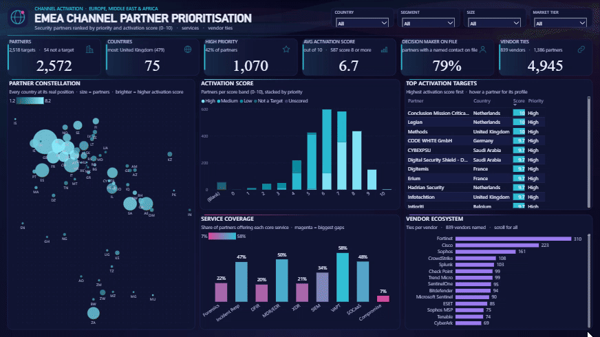

# EMEA Channel Partner Prioritisation (Power BI)

A one-page Power BI dashboard that ranks **2,572 IT and security partners in 75 EMEA countries** for a channel team:
*which partners should we work with first, and what should we offer them?* Every partner has a priority band, a 0–10
Activation Score and a services gap across 9 managed-security services, next to **4,945 partner–vendor ties**.

## What's inside
- **Partner constellation:** every country plotted at its real latitude and longitude from a lookup table (a map
  built from data, no map service). Bubble size = partners, brightness = average Activation Score; hover a country
  for its card, click it to filter.
- **Activation-score distribution by priority:** High 1,070 · Medium 1,241 · Low 205 · Not a Target 54.
- **Service coverage** across the 9 services.
- **Top activation targets**, ranked by score.
- **Vendor ecosystem:** 4,945 ties to 854 vendors.
- KPI tiles with live subtitles and slicers in the header. Click any visual to cross-filter the page; hover a
  partner to see its profile card.

## How it's built
- **Fixed, transparent scoring.** Points for missing services, partner fit (from the segment) and market tier give
  the priority band. The Activation Score adds size and "decision maker on file" (weights 3 / 2.5 / 2.5 / 1 / 1).
- **No false merges.** Partner + Country is not unique (35 pairs repeat), so each partner gets an index key, and
  the vendor register joins through a small distinct-key table built in Power Query.
- Power Query unpivots the 9 service columns. An unverified service counts as Unknown, not Missing, so gaps are not
  overstated.
- The 1920×1080 background artboard and theme are generated in Python.

## Open it
- Open `powerbi/EMEAChannelPartnerPrioritisation.pbip` in Power BI Desktop, set the **DataFolder** parameter, and
  Refresh.
- The partner data is private research and not included. The model expects `emea_partners.csv` and
  `emea_vendor_ties.csv`.
- Only a yes/no "decision maker on file" flag is kept: no names, roles or contact details.

**Tools:** Power BI (PBIP: TMDL + PBIR), Power Query (M), DAX, Python · built with Claude Code as a coding assistant
