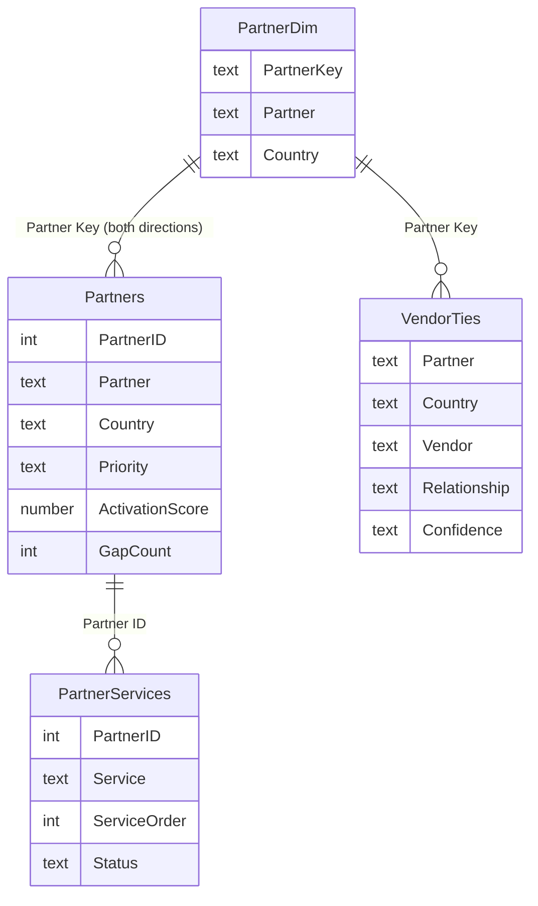

# EMEA Partner Activation

A partner-activation dashboard for **2,572 IT and security partners in 75 EMEA countries**. It answers one
question for a channel team: *which partners should we work with first, and what should we offer them?*

Every partner is scored with fixed, transparent rules:
- a **Priority band** (High / Medium / Low, or Not a Target);
- a **0–10 Activation Score**;
- a **services gap** across 9 managed-security services.

These are combined with a register of **4,945 partner–vendor ties**. This repository holds the method and the
dashboard rebuilt as a **Power BI Project** (Power Query, star-schema model, DAX, five report pages).

**Built with:** Power BI (Power Query M, DAX, PBIP / TMDL), Python for data preparation.

---

## The data

Partners were collected from public, checkable sources:
- vendor partner directories, authorised distributor lists and vendor award announcements;
- partner websites and IT-channel news;
- company databases and national company registries.

Each fact keeps a **source link** and a **confidence level** (High / Medium / Low). Every partner was checked for
both its vendor tie and its country.

| Dataset | Rows | What it holds |
|---|---|---|
| Partners | 2,572 | segment, size, the 9 services (Yes / No / unverified), fit, market tier, priority, activation score |
| Vendor ties | 4,945 | partner × vendor, relationship type, confidence, evidence link (854 vendors, 1,399 partners) |

## Scoring rules

**Five inputs, each derived rather than typed by hand:**

- **Missing services:** how many of the 9 services the partner does not offer yet. The services are Digital
  Forensics, Incident Response, DFIR, MDR/EDR, XDR, SIEM, VA/Pen Test, SOC-as-a-Service and Compromise Assessment.
- **Partner fit, from the segment:**
  - **Strong:** core security (MSSP/MDR, cyber consultancy, pen testing, IR/forensics, GRC).
  - **Medium:** adjacent segments (systems integrators, cloud/MSP, telcos with a cyber practice, resellers).
  - **Weak:** everything else.
- **Market tier:** countries are grouped into go-to-market priority tiers. Unlisted countries default to the
  lowest tier, and one market is handled separately as "Special". Changing a tier is a one-line change that
  re-scores every partner.
- **Size band, from the employee count's lower bound:** Large over 1,000, Mid 51–1,000, Small under 51, or Unknown.
- **Decision maker on file:** yes or no. Only the flag is used here; no contact data.

**Priority band:** add up the points below. High is 5 or more, Medium is 3–4 and Low is under 3. Product-only
vendors and non-security firms are labelled **Not a Target** instead of a band.

| Factor | Points |
|---|---|
| Missing services: 6 or more / 3–5 / 0–2 | 2 / 1 / 0 |
| Partner fit: Strong / Medium / Weak | 2 / 1 / 0 |
| Market tier: Tier 1 / Tier 2 / other | 2 / 1 / 0 |

**Activation Score (0–10):** missing services (up to 3 points), partner fit (2.5), market tier (2.5), size
(1, mid-size scores highest) and decision maker on file (1). The first three carry 8 of the 10 points.

**Result:**

| Priority | Partners | | Fit | Partners | | Market tier | Partners |
|---|---|---|---|---|---|---|---|
| High | 1,070 | | Strong | 1,177 | | Tier 1 | 1,238 |
| Medium | 1,241 | | Medium | 1,142 | | Tier 2 | 931 |
| Low | 205 | | Weak | 251 | | Tier 3 | 319 |
| Not a Target | 54 | | | | | Special | 83 |

Two records have no score yet and show as **Unscored**, not as a guessed band.

## Power BI model



- **Partner + Country is not a unique key.** 35 partner–country pairs appear more than once. These are different
  companies that share a name in the same country, with a different HQ, size and description. So `Partners` gets
  an **index key** (`Partner ID`) and no record is merged or dropped. The vendor register joins
  through a small **`PartnerDim`** table of distinct `Partner | Country` keys, built in Power Query, instead of a
  many-to-many relationship.
- **`PartnerServices`** is the 9 service columns **unpivoted in Power Query**. Each value is mapped to Offered,
  Missing or Unknown, and a lookup table gives each service its display name and sort order. This one table drives
  the services-gap matrix and the per-partner service list.
- **Data folder parameter:** all queries read CSVs through one `DataFolder` parameter, so the project opens on any
  machine, or from a OneDrive / SharePoint folder.

```m
Unpivoted  = Table.UnpivotOtherColumns(Kept, {"Partner ID"}, "Service Code", "Raw Status"),
Joined     = Table.NestedJoin(Unpivoted, {"Service Code"}, Lookup, {"Service Code"}, "L", JoinKind.LeftOuter),
WithStatus = Table.AddColumn(Expanded, "Status", each if [Raw Status] = "Yes" then "Offered"
                 else if [Raw Status] = "No" then "Missing" else "Unknown", type text)
```

**Measures:**

| Area | Measures |
|---|---|
| Partners | Partners, Target Partners, High / Medium Priority, Not a Target, Avg Activation Score, Decision Maker on File %, Avg Missing Services, Countries |
| Services | Offering, Missing, Offering % |
| Vendors | Vendor Ties, Partners With Vendor, Vendors |

```dax
Target Partners = CALCULATE ( [Partners], Partners[Priority] <> "Not a Target" )
Offering %      = DIVIDE ( [Offering], [Offering] + [Missing] )   -- unknowns are left out, not counted as missing
```

## Report pages

| Page | What it shows |
|---|---|
| **Activation Targets** | KPI cards, country / tier / priority slicers, the ranked partner table (by Activation Score), partners by priority and by segment |
| **Services Gap** | segment × service matrix of **Offering %** with a colour scale, partners missing each service, partners by number of missing services |
| **Vendor Partnerships** | vendor and relationship slicers, partners per vendor, the partner–vendor tie table |
| **Countries Matrix** | country × vendor matrix of partners with a colour scale, partners per country |
| **Partner Detail** | single-select partner picker, then the profile, scores, service list and vendor ties with evidence links |

*Report screenshots will be added once the report is published.*

## Data quality handling

- **Sizes:** employee counts arrive in several formats ("51-200", "1,001-5,000", "10,001+"). Each is parsed to a
  range and its lower bound, and the size band and sort order come from that bound.
- **Blanks before types:** empty strings become nulls before columns are typed, so numeric columns never fail to
  load.
- **Unverified is kept apart from "No":** a service with no evidence is **Unknown**, not Missing, so gaps are not
  overstated.
- **Personal data stays out:** the dashboard keeps only a yes/no "decision maker on file" flag. Names, roles,
  profile links, emails and phone numbers are removed before the data reaches Power BI. People's names are also
  removed from free-text fields (for example, founders named in a company description).

## Repository layout

```
powerbi/EMEAPartnerActivation.pbip     open this in Power BI Desktop
powerbi/*.SemanticModel/               TMDL model: tables, Power Query, measures, relationships
powerbi/*.Report/                      report pages and visuals (PBIR)
```

The partner data is not included: it is private research. The project expects `emea_velocity_partners.csv` and
`emea_velocity_vendor_ties.csv` in the `DataFolder` folder.
